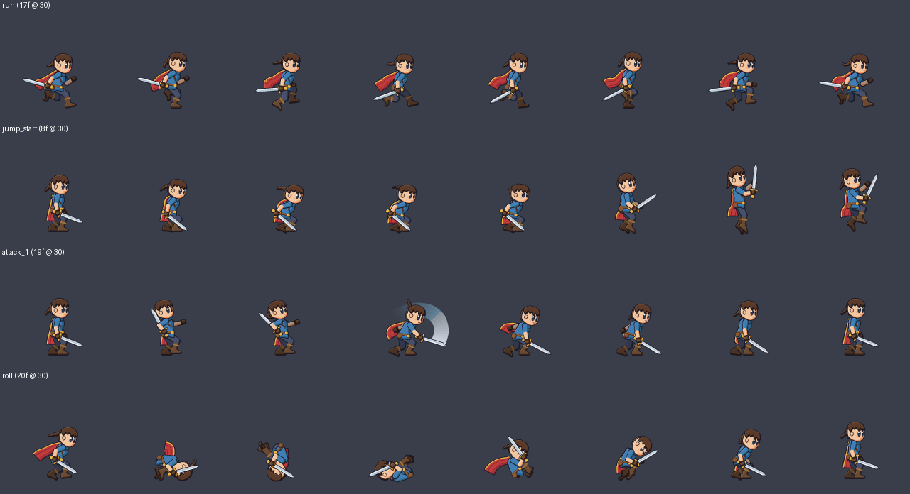
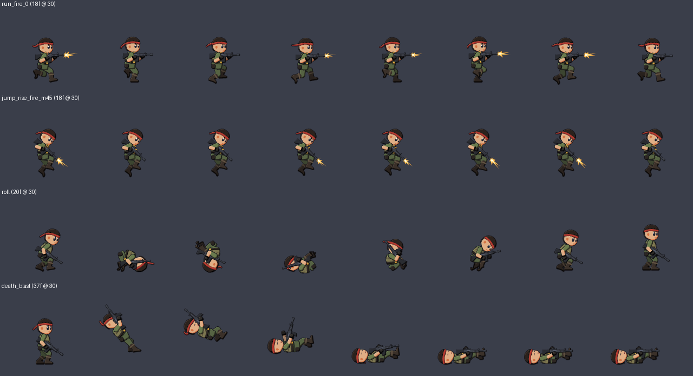
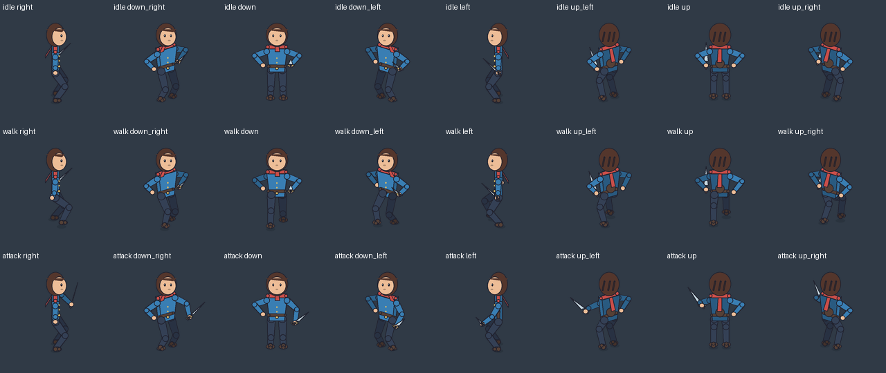
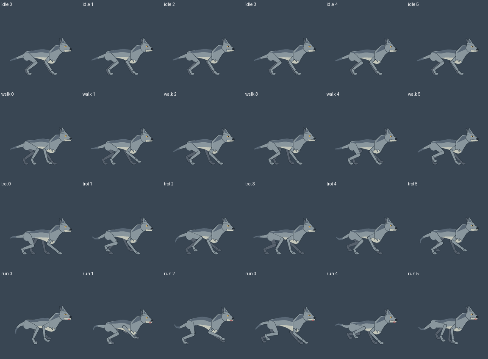
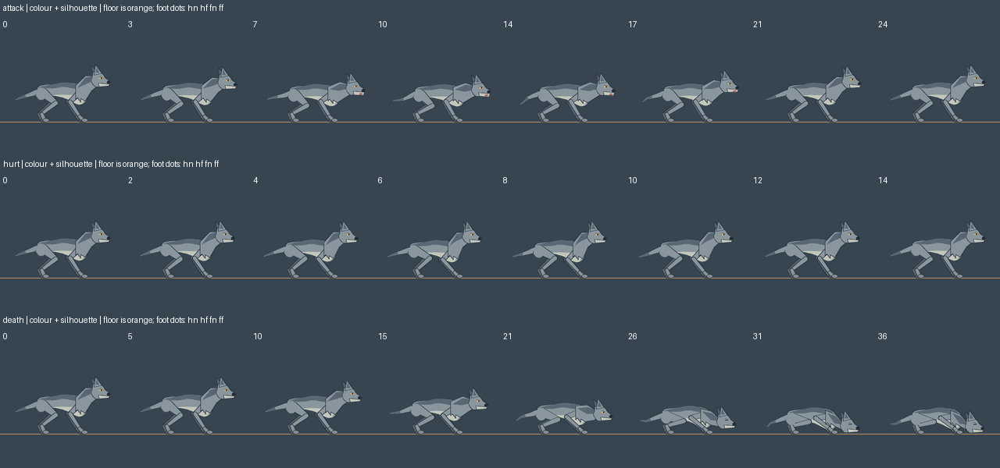

# 2D Game Skills

用 Claude 生成 2D 游戏角色动画的 skill：一句话描述角色，得到完整、流畅、可直接导入引擎的动作素材。

现在可试用统一入口 [game-animator](game-animator/SKILL.md)：安装 `game-animator.skill` 后按角色与视角选择下面四种模式。当前是打包和路由首版，各模式的角色配置仍各自独立。另有实验性配置驱动飞行流程，支持刚性 PNG 部件和基础动作，但示例只是骨架占位，尚未完成生物美术和引擎实测。旧的四个包仍可单独使用。

| Skill | 适合 |
|---|---|
| [game-sprite-animator](#game-sprite-animator) | 横版 RPG、动作游戏：刀剑、法术、跳跃、翻滚 |
| [game-shooter-animator](#game-shooter-animator) | 横版射击游戏：持枪士兵、多方向瞄准、开火、换弹 |
| [game-topdown-animator](#game-topdown-animator) | 3/4 俯视 RPG：自由移动、八方向、人形角色 |
| [game-quadruped-animator](#game-quadruped-animator) | 侧视四足狼：待机、走、慢跑、奔跑 |

## game-sprite-animator



每一帧都由骨骼和连续曲线计算生成，因此帧率可以随意设定，循环首尾闭合，走路时脚不打滑。

- **27 个动作：** 待机、走、跑、急停、起跳、上升、滞空、下落、落地、二段跳、蹲下、蹲行、翻滚、冲刺、贴墙下滑、三连击、空中攻击、施法、格挡、受击、死亡等
- **两种风格：** 高清卡通（默认 256px、30fps，可选 60fps）和像素风（48、64、96px）
- **5 个角色模板：** 英雄、骑士、法师、忍者、哥布林，可自定义外形、配色、武器和动作手感
- **细节：** 披风、头发、围巾由物理模拟带动，有脚步滚动、挤压拉伸、表情和刀光，并附带尘土、火花等特效素材
- **自己的美术：** 把分层 PNG 绑到骨骼上，复用同一套动作
- **骨骼约束：** 头、脊柱、肘关节有软限位，翻滚和倒地时身体贴地，武器、脚和披风不穿地
- **质检工具：** 检测重复帧、循环接缝、跳帧、滑步和动作衔接，以及武器挡脸、武器或身体穿地、画面被帧边缘裁切；也能检查已有的序列帧
- **AI 视觉质检：** 生成审查图，由 Claude 逐张看图，找出数值查不到的问题，比如身体悬空、关节反折、剪影看不出动作，并记录结论
- **自动适配大小：** 按最大的动作缩放角色，保证任何一帧都不出画
- **导出：** 序列帧、精灵图、图集、`animations.json`，以及 Unity、Godot、Cocos、Phaser、PixiJS、H5 CSS 和 Canvas 播放器所需的文件。Godot 4.3、Phaser 3、PixiJS 8 和浏览器 CSS 已实测导入和播放，逐帧和原图一致；Unity、Cocos 尚未实测

每次生成都会附带 `preview.html`，可以逐个查看动作，也可以用键盘试玩。
为横版人形添加的自定义动作可在试玩页选择并按 Q 播放；导出时需要包含 `idle` 和该动作。

## game-shooter-animator



参考合金弹头的做法，把上半身和下半身分开：任意移动可以配任意瞄准角度和武器，帧数不会爆炸。

- **6 种枪：** 手枪、冲锋枪、步枪、霰弹枪、狙击枪、火箭筒，每种有自己的射速、后坐力、换弹动作和枪口位置
- **9 个瞄准方向：** 每 22.5° 一档，从正上方到正下方，扶枪的手始终握在枪上
- **分层动作：** 下半身有待机、走、跑、后退、蹲、跳跃；上半身每种武器都有瞄准、开火、换弹、投弹、枪托攻击、切枪
- **整身动作：** 冲刺、翻滚、滑铲、受击、死亡、炸飞、胜利
- **烘焙组合：** 比如跑动射击、待机瞄准，给只想每个状态一张精灵图的引擎或 H5 用
- **4 个角色模板：** 突击兵、特警、狙击手、雇佣兵
- **射击手感：** 射速对齐整帧，每发都有枪口火光；每帧都标了枪口位置，子弹从枪口射出；换弹、投弹、开枪都有事件帧
- **质检：** 与 game-sprite-animator 相同的骨骼约束、数值检测和 AI 视觉质检，另外检测握枪间隙和射击节奏
- **导出：** 与 game-sprite-animator 相同（H5 CSS 只包含整身动作），另有每帧的上半身挂点 `anchor` 和枪口 `muzzle`

`preview.html` 里有可试玩的靶场：鼠标瞄准、开火、换弹、投弹、切枪，同时也是游戏里接入分层动作的参考实现。

## game-topdown-animator



用于自由移动 RPG 的 **3/4 俯视八方向人形角色**，独立于两个横版 skill。

- 待机、走路、奔跑、攻击、受击、死亡，每种动作烘焙八个朝向，共 48 个片段。
- 两个角色模板：蓝衣旅行者 `wanderer`、绿兜帽守卫 `warden`，可改配色，支持高清和像素。
- 固定相机下计算地面和肢体高度；正面、背面、侧面和斜向有不同外观和遮挡。
- 八向自由移动，斜向速度归一化，转向和走跑切换保留步态进度。
- 质检覆盖朝向/数据完整性、方向间时序、地面平面滑步、固定骨长、循环接缝及画面裁切。
- 同样导出图集、序列帧、Godot、Phaser/PixiJS、CSS 等文件，附八方向图库和可键盘试玩的预览。

```bash
cd game-topdown-animator
python scripts/generate.py --character assets/characters/wanderer.json --preset pixel --out out/wanderer
python scripts/qa_motion.py out/wanderer
python scripts/visual_review.py out/wanderer
```

第一版只包含持剑人形、固定 3/4 相机。左方向是已烘焙的镜像，会改变装备左右手；
不支持独立瞄准、自定义分层 PNG、物理布料或怪物骨骼。数值通过不代表视觉完美，仍需看审查图和试玩。
接入与验证范围见 [integration.md](game-topdown-animator/references/integration.md)。

## game-quadruped-animator



侧视四足狼首版，具有分段脊柱、四条三段腿和模拟尾巴：

- 四个循环：idle、walk、trot、run；慢跑对角腿配对，奔跑为交错前后腿并带腾空段。
- 四只脚分别检查落脚、滑步、抬脚高度和事件；骨长、膝肘方向、尾巴根部与地面也参与质检。
- 高清与像素素材，同一 pivot，向左在引擎水平翻转，附键盘步态试玩。
- 与已有 skill 共用图集导出和尾巴链模拟，关节记录接口也与侧视人形共用；各 skill 仍独立安装。

```bash
cd game-quadruped-animator
python scripts/generate.py --character assets/characters/wolf.json --preset pixel --out out/wolf
python scripts/qa_motion.py out/wolf
python scripts/visual_review.py out/wolf
```



现已加入前探咬击、受击、伏地死亡，合计七个动作；试玩 J/H/X 触发战斗与复活，训练靶按事件帧记录命中。尚无俯视四足或接触约束的步态混合。
使用和验证范围见 [SKILL.md](game-quadruped-animator/SKILL.md) 与 [integration.md](game-quadruped-animator/references/integration.md)。

## 安装

四个 skill 互相独立，按需安装。四足包为 [`game-quadruped-animator.skill`](game-quadruped-animator.skill)。俯视包为 [`game-topdown-animator.skill`](game-topdown-animator.skill)。

**Claude 桌面版：** 下载 [`game-sprite-animator.skill`](game-sprite-animator.skill) 或 [`game-shooter-animator.skill`](game-shooter-animator.skill)，在 Claude 中打开文件并保存为 skill。

**Claude Code：** 把 [`game-sprite-animator/`](game-sprite-animator)、[`game-shooter-animator/`](game-shooter-animator) 、[`game-topdown-animator/`](game-topdown-animator) 或 [`game-quadruped-animator/`](game-quadruped-animator) 文件夹复制到 `~/.claude/skills/`。

需要 Python 3，以及 `pillow` 和 `numpy`：

```bash
pip install pillow numpy
```

## 使用

装好后直接描述需求，Claude 会自动完成生成、质检和导出：

```text
做一个像素风的绿皮哥布林，拿长矛，要待机、走路、跑步、跳跃和攻击，用在 Phaser 里
```

```text
做一个合金弹头风格的像素士兵，拿冲锋枪和手枪，要跑动射击、跳跃、换弹和死亡，做 H5 小游戏
```

如果没有自动触发，可以点名：

```text
用 game-sprite-animator 做一个穿黑色斗篷的刺客
```

Claude 生成后会先跑数值检测，再逐张看审查图，有 bug 级问题会先修好再交付。

也可以不通过 Claude，直接运行脚本：

```bash
cd game-sprite-animator
python scripts/generate.py --character assets/characters/hero.json --preset hd --out out/hero
python scripts/qa_motion.py out/hero
python scripts/visual_review.py out/hero
```

射击 skill 用法相同，在 `game-shooter-animator` 目录下运行，角色模板换成 `assets/characters/commando.json` 等。

预设有 `hd`、`hd60`、`hd512`、`pixel48`、`pixel`、`pixel96`。

## 接入游戏时注意

1. 移动速度使用 `animations.json` 里的 `speed_px_s`，否则会滑步。
2. 锚点使用文件里的脚底 `pivot`，不要用每帧图片自己的边界，否则角色会抖动。
3. 起跳、出伤害、脚步声用 `events` 标注的帧来触发。

射击 skill 还要注意：

4. 分层动作要把上半身画在下半身当前帧的 `anchor` 上。
5. 子弹从 `muzzle[frame]` 加 `anchor` 的位置射出，不要用固定偏移。
6. 瞄准角度变化时保留开火动作的当前帧，否则射速会变慢。

各引擎的接入方法见 [engine-integration.md](game-sprite-animator/references/engine-integration.md) 和 [integration.md](game-shooter-animator/references/integration.md)。

## 当前限制

- 两个横版 skill 只支持侧视人形角色，没有四足、飞行或史莱姆类骨骼，也没有俯视角和正面视角。射击 skill 也不支持载具、炮台和第一人称枪械。
- 角色只有一个朝向，向左时用引擎的水平翻转。
- 射击 skill 没有分层美术模式，不能绑定自己的 PNG；分层动作里，头上的布条（如头带）在跑动时不会随风飘，烘焙组合和整身动作里会。
- AI 视觉质检是 Claude 看静态帧的判断，看不出动作在播放时的手感，最终效果请在 `preview.html` 里播放确认。
- 引擎导出文件都没有在对应引擎里实测过：Unity 导入脚本未编译，Godot 和 Cocos 文件做过结构校验，`sprites.css` 和 `atlas.json` 也只查过结构。具体情况见 [engine-integration.md](game-sprite-animator/references/engine-integration.md) 和 [integration.md](game-shooter-animator/references/integration.md) 中的验证表。
