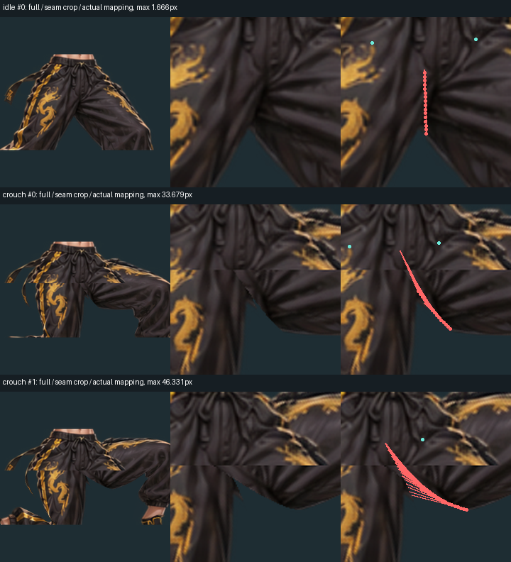
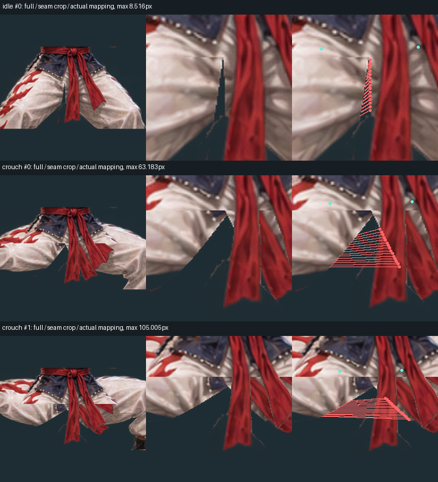

# 骨骼配准与裤裆接缝漏审修复（2026-11-04）

用户指出街头对决中烈影蹲姿腰胯开裂、寒锋站姿裤裆出现竖缝，要求暂停游戏开发，先修 skill。
本轮只修改 skill 的输入约束、测量工具、审核门禁及回归证据，不修改或发布游戏。

## 之前漏审了什么

游戏 `3640b6a` 的 `rig.js` / `skin.js` 是手写的独立蒙皮，并不是此 skill 的分层导出。
它没有对应的 `visual_report.json`、`qa_report.json` 或完整绑定审核产物。之前的游戏单测、原图
SHA 与绑定静止姿态保真检查，都不能证明动态衣服连续，更不能声称该游戏已通过 skill 视觉审核。
之前看图后宣称通过的结论不成立。

实际结构把完整裤装沿髋部中线分成近/远两片，每片仅受自己的腿骨控制。两腿分别 IK 后，同一个
原图布料点映射到了不同位置；站立时形成细缝，深蹲时形成大缺口和水平切边。WebGL、Canvas 都能
复现，不能归结为某种 GPU 的抗锯齿。

skill 原审查图包含全身、肘膝、肩臂，却没有逐动作的腰/髋/裆特写。原 `check_core` 检测区止于
腰到髋的 0.85 处，不覆盖下方裤裆桥；独立腿根与身体接触也不证明两腿之间的裤布完整。
本轮没有放宽这些旧阈值，而是增加独立的接缝约束和所需视觉证据。

## 修改

1. `shared/scripts/audit_skin_binding.py` 读取实际源点、权重、逐帧矩阵和隔离 RGBA，计算注册关节点
   与共享源边界。共享布料点分离超过 0.5 输出像素、关节点配准超过 1 输出像素即失败。报告逐动作、
   逐帧定位，不修改原始素材；缺输入为 invalid，数值通过仍是 `visual_status: pending`。
2. `shared/scripts/visual_review.py` 为每个全身人形动作生成高倍腰胯干净图与实际骨线图，覆盖静止、
   首尾、最深蹲、最大分腿、髋膝极值和有元数据的原画切换邻帧。`rig_alignment`、
   `pelvis_continuity` 必须逐候选动作/帧写观察；缺骨线、缺图、漏观察、未解决问题不能通过。
3. 审核版本绑定必需审查图与覆盖清单、帧、图集、精灵图、运行预览、引擎文件及存在的绑定审计。
   自定义渲染器声明 `binding_audit_required` 后，删除或只提供部分动作的报告不能清除门禁。
   审计输入帧还须与实际审查帧逐项匹配尺寸和解码RGBA，不能用同名/同帧数的别图冒领证据；
   `--check` 重验问题注册表和已存历史，直接改当前报告为pass不能抹掉未解决问题。
4. 更新原模式、统一入口与说明，禁止把两条独立半裤当成完整骨盆，禁止用不相关的合成角色或游戏
   测试数量代替实际渲染证据。旧报告必须按当前素材与新版审核清单重审。

独立反向审查确实在新版初稿里发现了同名帧冒领、手改报告删问题、错误 `layer` 跳过全身审核三个
入口；它们均纳入故障回归。`layer` 仅接受未分层、`upper`、`lower`，无效枚举拒绝。

## 两个真实拒绝样本

保存在 `dev/fixtures/split_pants/`，每人有源图参考、三个实际腰胯 RGBA 裁片、真实矩阵和权重。
来源、原 PNG SHA 和裁片坐标变换见该目录的 README。它们是**应失败**的回归，不是修好的人物。

| 角色 | 待机声明 LBS 点最大分离 | 半蹲 | 满蹲 |
| --- | ---: | ---: | ---: |
| 烈影 | 1.666 px | 33.679 px | 46.331 px |
| 寒锋 | 8.516 px | 63.183 px | 105.005 px |

这两例髋关节点映射误差都低于 0.000001 px，但每个姿态的接缝仍被拒绝。回归还检查真实 RGBA
中确实存在透明裂口，并验证 CLI 失败且没有重画证据。这也不证明原图髋关节标得解剖正确：
源关节与目标关节可能一起标错，原画叠骨线仍须审查。

这些数值来自原权重函数在声明点的连续 LBS，不冒充最终 GPU 像素误差。实际 WebGL 的42格网格先
蒙皮顶点，再在三角形内插值；与声明点直接 LBS 的最大位置差为烈影0.123px、寒锋0.055px；
Canvas16格网格的最大差为0.729/0.380px。独立按实际网格重算的六个姿态均仍失败，实际RGBA
也保留可见裂口。精确审计任意网格内部点需要真实顶点、索引和重心映射，不应混称逐像素真值。

以下是审核器对真实拒绝样本生成的诊断，红线连接同一原布料点被错误拉开的两个位置；
它们明确展示未修复的错误，不是“通过”效果图。





## 边界

新增测量检查显式登记的源点与共享边，不会自动理解所有衣服轮廓，也不会补全隐藏布料。
人工错误标点、漏标的接缝、动作观感仍须看原图、放大图和播放结果。门禁能要求证据、拦住已测的
错误和旧结论，不能让一句人写的“通过”自动成为视觉事实。

游戏中的人物目前仍是用户拒绝的版本。后续修游戏必须使用完整骨盆/裤装连接及当前审核证据；
本次 skill 改进不撤销这些问题，也不声称游戏动作已修好。

## 验证记录

- 已整合主分支 `09e02c9`，保留其中的采样、播放时钟、QA、预览、关节识别与自定义图集页门禁。
  最终代码提交 `5a8900d` 的核心门禁58项通过；新增绑定工具16项、真实裂缝3项都包含在内。
  三项反向绕过使用原攻击输入复核后均拒绝，合法修复后重审正例仍能通过。
- 完整集合采用独立进程逐模块、三并发运行：77模块，最终632项，0失败、0错误、0跳过、
  6项既有expectedFailure、0意外成功，运行期间被测源文件哈希未变。验证脚本初次遗漏工程根目录
  的sys.path，造成两个模块3个导入错误；补根路径后这两组22/9项单独重跑通过，初次日志与重跑
  结果均保留。旧基底未完成的单进程运行不计作完整通过。
- 26套传统生成/QA命令整体退出0；普通基线比较为0个状态回退。`cutout_demo`的pixel/HD原有
  7/8项WARN保留，没有删项或调阈值。
- **严格像素基线未通过**：仍有116个changed clip、102项numeric drift，退出1。修改前的
  `d7e4280:docs/rig-stability-validation.md`已记录同样的116/102差异。相对新基底`09e02c9`，
  本轮未改生成器、rig、motion、puppet渲染或旧QA算法，也未更新baseline掩盖差异；不将这个
  结果写成严格逐像素通过。
- 重新打包的独立人形包、统一包均解压实际运行，两个坏样例都退出1、保持fail。共享源/独立副本、
  统一快照、五个包新鲜度与diff检查通过；其余未改模式的包保持不变。
- 完整结果在工作区`/workspace/work/skill-validation/integrated-suite/final-summary.json`；
  初次运行结果保留在同目录`summary.json`，两组环境修正重跑在`integrated-suite-reruns/`。

核心复核命令：

```bash
PYTHONPATH=dev/tests python -m unittest test_visual_gate test_pelvic_visual_gate test_skin_binding_audit test_split_pants_regression test_repo test_unified_skill -v
CHROMIUM_EXECUTABLE_PATH=/usr/bin/chromium python -m unittest discover -s dev/tests -v
bash dev/regress_all.sh
python dev/baseline.py
python dev/baseline.py --strict
python dev/sync_shared.py --check
python dev/sync_modes.py --check
python dev/package_skills.py --check
```

相同模块隔离集合可顺序复核（上面的discover是一进程标准入口）：

```bash
for file in dev/tests/test*.py; do
  CHROMIUM_EXECUTABLE_PATH=/usr/bin/chromium PYTHONPATH=.:dev/tests python -m unittest "$(basename "$file" .py)" -v || exit $?
done
```
